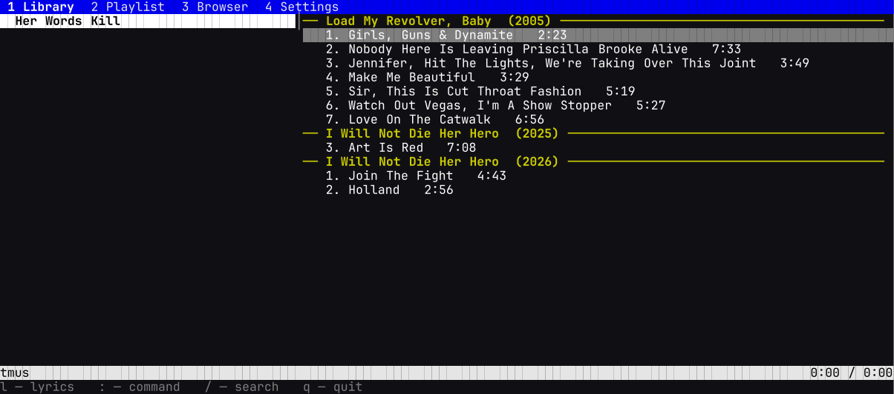
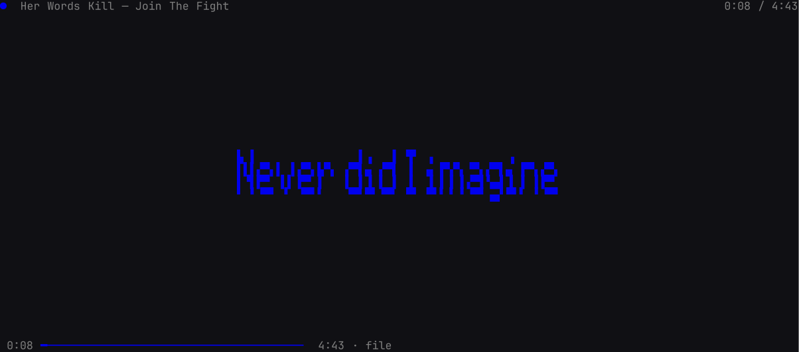

# tmus



Terminal music player, in the spirit of cmus. Plays through mpv, shows up in
playerctl through MPRIS, and has a lyrics screen with big letters and cava bars
behind them.

Four screens: library, playlist, browser, settings.

## Install

Packages are on the [releases page](https://github.com/JemmaperXD/tmus/releases).

Debian/Ubuntu:

```sh
sudo apt install ./tmus_0.1.0_amd64.deb
```

Anything else, from the tarball:

```sh
tar -xzf tmus-v0.1.0-x86_64-linux.tar.gz
./tmus
```

To build you need stable Rust, mpv and dbus headers (`dbus` on Arch,
`libdbus-1-dev` on Debian). cava is optional.

```sh
cargo build --release --offline
install -Dm755 target/release/tmus ~/.local/bin/tmus
```

Crates are vendored in `vendor/`, so the build works offline.

## Usage

```sh
tmus
tmus ~/Music
tmus ~/Music/album/*.flac
```

No arguments opens `~/Music` (or `~/music`). To see the banner font alone:

```sh
tmus --banner "When you were here before" --width 100 --height 28
```

## Keys

```
1-4            library, playlist, browser, settings
Tab            next column, or next screen
j/k, arrows    down/up
g/G, Home/End  top/bottom
Enter, x       play
c, space       pause
v              stop
b/z, B/Z       next/prev track, next/prev album
left/right, h  seek 5 seconds, , and . seek a minute
s, r           shuffle, repeat
Ctrl+R         repeat this track
/              search
l              lyrics
F1, ?          full key table
q              quit
```

Playback and list keys can be remapped in settings, navigation stays fixed.
`tmus help` has the rest: playlist builder on `Ctrl+N`, tag editor with `:edit`,
browser keys.

Search takes `//word` for artists and albums, `??word` for titles.

## Lyrics



It looks for a `.lrc` next to the track, by full filename or by title and
artist. `[mm:ss.xx]`, several stamps per line, `[offset:…]` and `<mm:ss.xx>` all
work. Plain text too, it just doesn't scroll.

Without a local file it tries embedded lyrics, then lrclib.net, and caches the
answer. `r` skips the file and cache and asks again. `Ctrl+S` saves the current
lyrics as `.lrc`, `Shift+L` hides the text and leaves the cava background.

Latin text uses smblock, everything else the built-in 5×7 font.

## Commands

`:` opens the command line. Prefixes are enough, so `:a` is `:add` and `:w` is
`:save`.

```
:add [-l|-p] PATH       file, directory or playlist
:cd [DIR]               browser directory
:save [-e] [-l|-p] FILE
:load [-l] FILE
:edit                   tags and embedded lyrics
:set KEY=VALUE          modes, offset, cava
:seek N                 +N and -N are relative
:view 1..4
:rescan                 add new files, drop missing
:help
:quit
```

`:set` and `:toggle` take repeat, shuffle, follow, continue, repeat_current,
aaa_mode, play_library, show_remaining_time and cava. Offset is `offset=N`.

## MPRIS

It registers `org.mpris.MediaPlayer2.tmus` with metadata, play/pause/stop,
next/previous, seek, shuffle and loop, so `playerctl -p tmus play-pause` and
friends work.

Volume stays with mpv and the mixer. MPRIS reports 100% and ignores writes. If
something else holds the name, tmus keeps running without MPRIS and retries.

## Files

```
~/.local/share/tmus/library.json
~/.local/share/tmus/playlists/*.m3u
~/.config/tmus/state.json
~/.cache/tmus/lyrics/
~/.cache/tmus/cava.conf
```

XDG variables are respected. One instance at a time, the lock sits in
`$XDG_RUNTIME_DIR` or `~/.cache/tmus`.

## Thanks

mpv for playback, ratatui and crossterm for the UI, lrclib.net for lyrics, and
Sam Hocevar for the smblock font (WTFPL v2). MIT.
